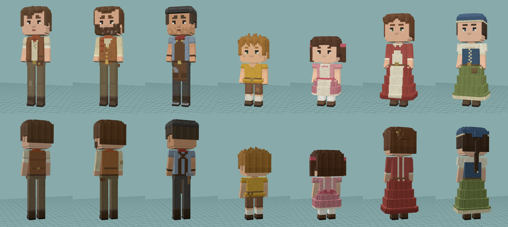

# GLBmodel

ボクセル調キャラクターの GLB モデル集です。1ボクセル = 0.026m で、`heroine.glb` と同じく「スキンメッシュ1つ + パレットテクスチャ1枚」の構成です。

## villagers_v2/（新版）

村人7体を最初から作り直した版です。子どもと女性は「目を小さく・頬の赤みなし・口なし」にしています。



| ファイル | キャラクター |
|---|---|
| villager.glb | 青年。革のベスト、ネッカチーフ、腕まくり、ベルトポーチ、膝当て |
| villager_man_a.glb | ひげの中年男性。ふくらんだお腹、ボタン付きベスト、胸に垂れるスカーフ |
| villager_man_b.glb | 職人。ハンチング帽、革エプロン、道具入りポケット、腰のハンマー、無精ひげ |
| villager_child_a.glb | 男の子。ツンツン頭、そばかす、継ぎ当て付きの半ズボン、パチンコ |
| villager_child_b.glb | 女の子。ツインテール、エプロンドレス、背中のリボン |
| villager_woman_a.glb | 女性。お団子髪、赤いドレスとエプロン |
| villager_woman_b.glb | 女性。青いスカーフ、編み込みの三つ編み、紐留めの胴着、薬草袋 |

### 作り

- **骨格**: Root / Hips / Spine / Chest / Neck / Head / {L,R}UpperArm・LowerArm・Hand・Thigh・Shin・Foot。
  追加ボーン: `Skirt`（スカートの3体）、`{L,R}Tail1-2`（女の子のツインテール）、`Braid1-3`（woman_b の三つ編み）
- **スキン**: 関節まわりは2ボーンのやわらかいウェイト。肘や膝がなめらかに曲がり、面は割れません
- **瞬き**: `<名前>_Lids` メッシュのモーフターゲット `Blink`（アニメーションに組み込み済み）
- **スカート**: しゃがんだり膝をついたりしたとき、`Skirt` ボーンの縮小で裾が床にめり込まない
- **足の接地**: 足が床に付くよう全フレームを自動補正（ジャンプなど空中の動きを除く）

### アニメーション（19種）

heroine.glb と同じ名前: `Idle` `Walk` `Run` `Wave` `Nod` `Bow` `Pray` `Surprise` `Joy` `Shy` `Hurt`
追加: `ShakeHead` `Talk` `Sad` `Clap` `Point` `Panic` `Cower` `Defeat`

`Idle` `Walk` `Run` `Talk` `Sad` `Clap` `Panic` はループ用、それ以外は1回再生用です（`Defeat` は膝をついてうなだれた姿勢で終わります）。

### 再生成

```
pip install numpy pillow
python3 tools/villagers_v2.py              # villagers_v2/ に出力
python3 tools/villagers_v2.py out villager # 1体だけ out/ に出力
```

- `tools/vox2.py` … ボクセルの面生成、スキン、瞬き、接地補正、GLB 書き出し
- `tools/charkit.py` … 体・顔・髪・服の共通部品
- `tools/anim2.py` … アニメーション（腕の到達位置は逆運動学の簡易ソルバーで決定）
- `tools/villagers_v2.py` … 7体の定義

## villagers/（初版）

最初に作った村人7体です。`python3 tools/villagers.py` で再生成できます（`tools/voxlib.py` を使用）。
